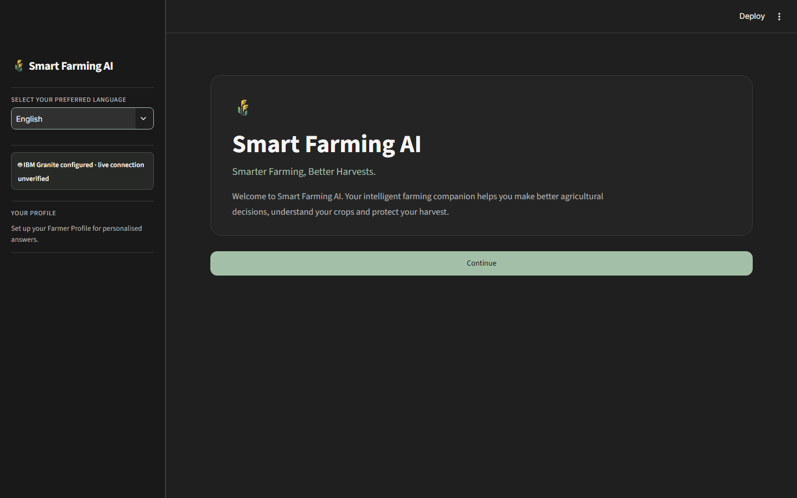
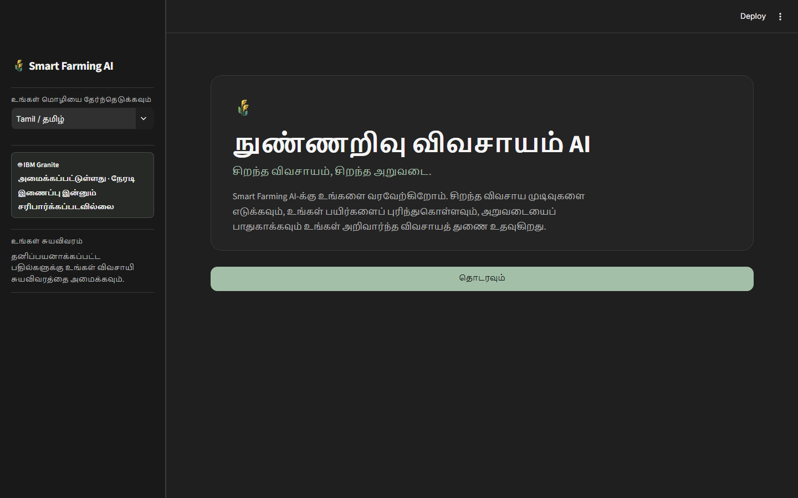
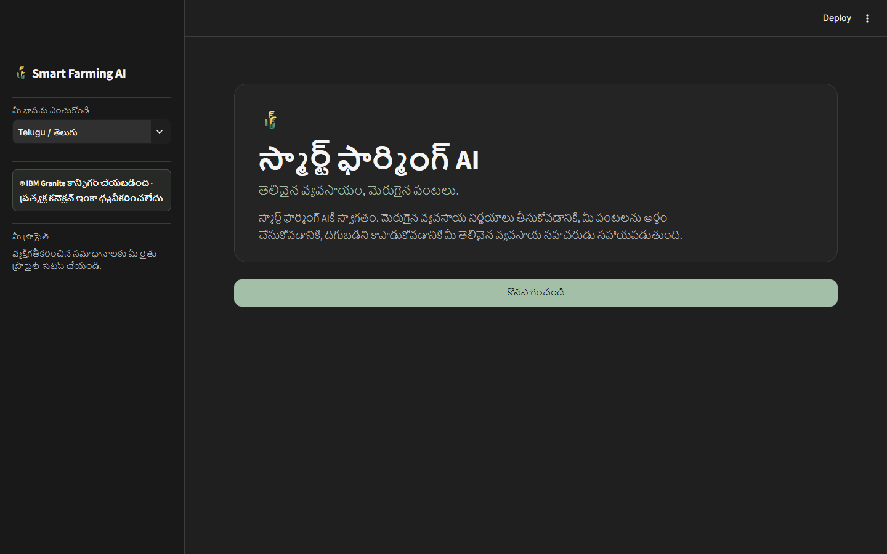
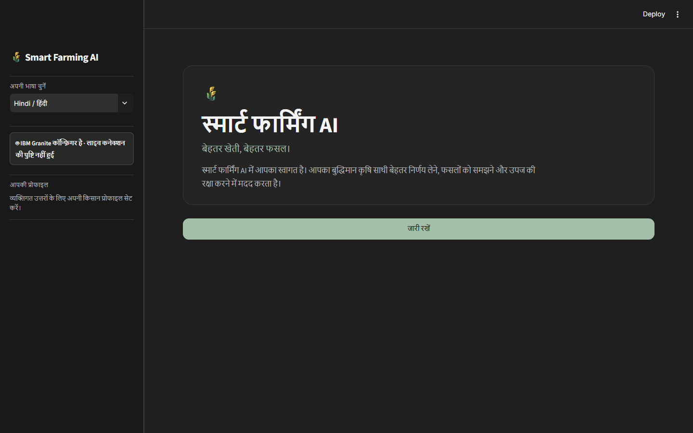
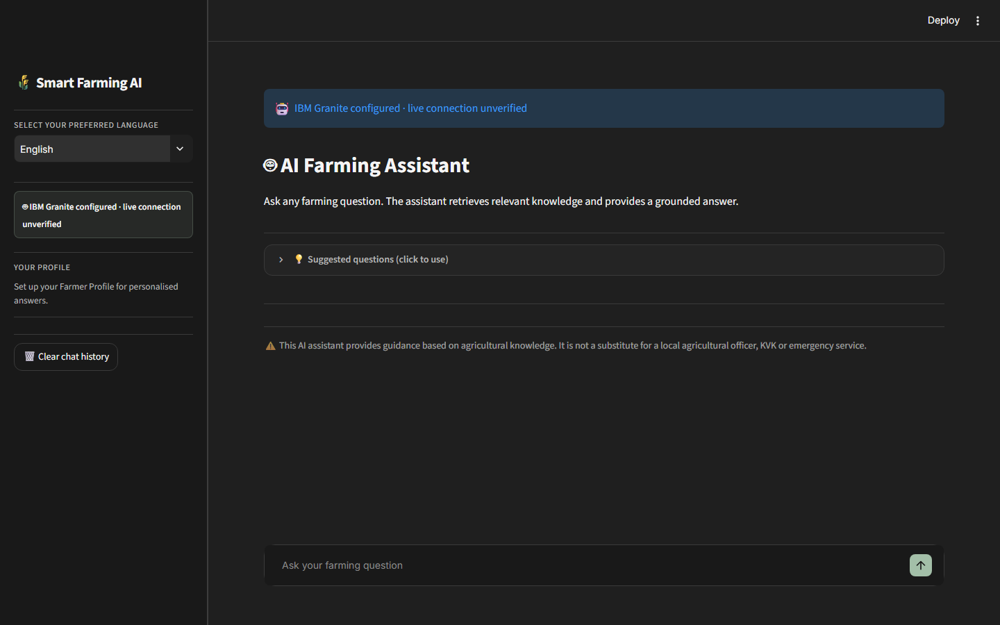
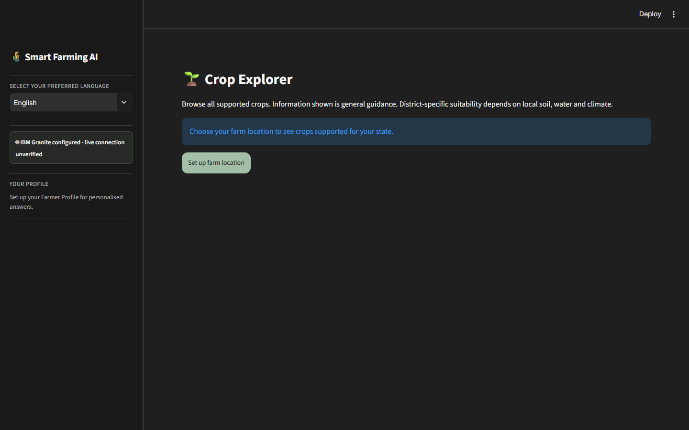
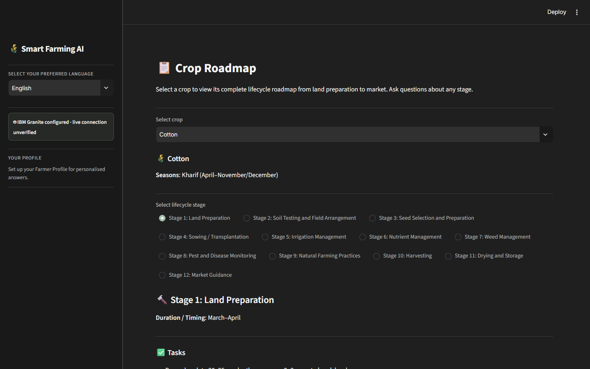
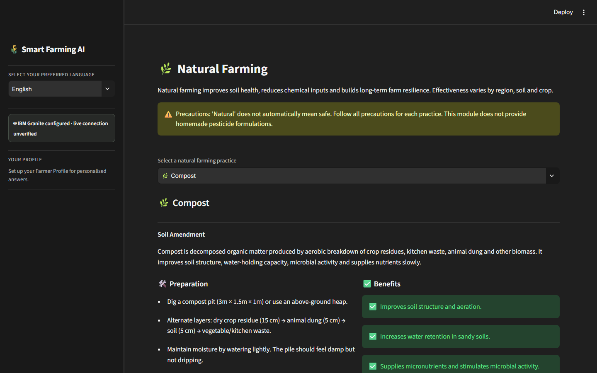
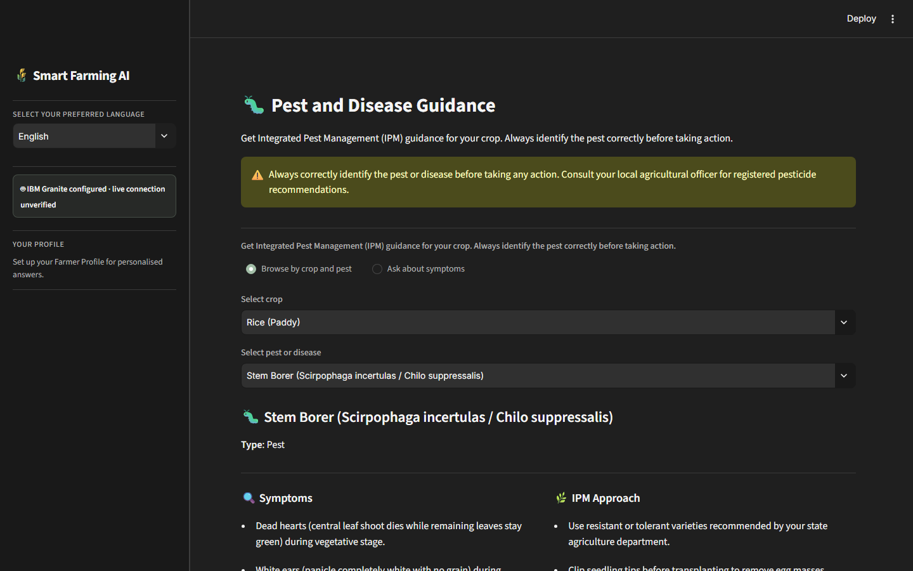
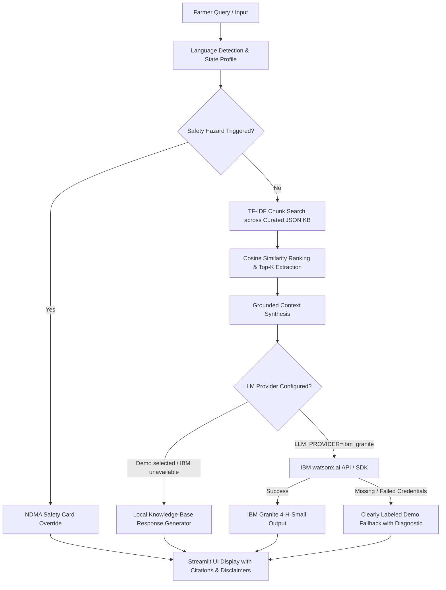

# Smart Farming AI – Multilingual Farmer Assistant

[](https://www.python.org/)
[](https://streamlit.io/)
[](https://edunetfoundation.org/)
[](https://www.ibm.com/watsonx)
[](https://scikit-learn.org/)
[](https://opensource.org/license/mit/)

**Smart Farming AI** is a multilingual agricultural advisory system developed as an internship project assigned by **Edunet Foundation**. The project represents a practical learning and development initiative focused on exploring **IBM watsonx.ai and IBM Cloud** technologies and applying artificial intelligence to real-world Indian agricultural use cases.

The application combines a grounded **Retrieval-Augmented Generation (RAG)** pipeline with user interface localization in **English**, **Tamil (தமிழ்)**, **Telugu (తెలుగు)**, and **Hindi (हिंदी)**. It supports live **IBM Granite** inference through **IBM watsonx.ai** and provides a clearly labeled local **Demo Mode** as a fallback and testing option, backed by the agricultural knowledge base.

## Live Application

- **Full application:** [Open Smart Farming AI](https://smart-farming-ai-agent-vbwt2aa878cqedgsyaxu9a.streamlit.app/)
- **AI Farming Assistant:** [Open the AI Assistant](https://smart-farming-ai-agent-vbwt2aa878cqedgsyaxu9a.streamlit.app/AI_Farming_Assistant)
- **Source code:** [GitHub repository](https://github.com/syeedarshad/Smart-Farming-AI-Agent)

---

## Table of Contents

- [Live Application](#live-application)
- [Project Overview](#project-overview)
- [Internship Project](#internship-project)
- [Key Features](#key-features)
- [Application Screenshots](#application-screenshots)
- [Technology Stack](#technology-stack)
- [System Architecture & Workflow](#system-architecture--workflow)
- [Project Structure](#project-structure)
- [Installation and Setup](#installation-and-setup)
- [Environment Configuration](#environment-configuration)
- [Running the Application](#running-the-application)
- [Running Tests](#running-tests)
- [IBM Granite Integration](#ibm-granite-integration)
- [Cotton Pest Management and Multilingual Retrieval](#cotton-pest-management-and-multilingual-retrieval)
- [Data Sources and Limitations](#data-sources-and-limitations)
- [Responsible AI & Guardrails](#responsible-ai--guardrails)
- [Future Enhancements](#future-enhancements)
- [Acknowledgements](#acknowledgements)

---

## Project Overview

Indian agriculture supports hundreds of millions of livelihoods across diverse agro-climatic zones, soils, and languages. However, smallholder and regional farmers frequently encounter critical information barriers:

- **Linguistic Divide:** Crucial agronomic advisories and weather alerts are predominantly published in English or standardized Hindi, leaving non-Hindi regional farmers underserved.
- **Fragmented Lifecycle Guidance:** Farmers often lack structured, sequential guidance covering all stages—from land preparation, seed selection, and sowing to pest protection, harvesting, and post-harvest storage.
- **Risk of LLM Hallucinations:** Generic foundation models often generate unverified chemical recommendations or hallucinated agricultural metrics that could damage crops or harm farm health.
- **Connectivity and Cost Constraints:** Rural communities require solutions that can run reliably in lightweight environments without high ongoing cloud API expenses.

**Smart Farming AI** directly addresses these challenges by implementing:
1. **Full Regional Localization:** Four-language native navigation and content presentation (English, தமிழ், తెలుగు, हिंदी).
2. **Deterministic RAG Retrieval:** Agricultural knowledge is retrieved from curated public domain sources using TF-IDF vectorization and cosine similarity scoring.
3. **Dual Execution Modes:** A zero-credential offline Demo Mode for instant deployment and testing, coupled with an enterprise-ready IBM Granite watsonx.ai provider.
4. **Safety-First Guardrails:** Immediate hazard override detection prioritizing emergency protocols (cyclones, lightning, floods, heatwaves, chemical safety) over standard agronomic tips.

> **Architecture Clarification:** This repository is implemented as a **modular single-agent Streamlit application** powered by a deterministic TF-IDF RAG pipeline and specialized domain services. It does *not* use multi-agent frameworks or Langflow orchestration.

---

## Internship Project

### Background & Objective
This application was developed as a practical internship assignment from **Edunet Foundation** as part of a technical learning and development program focused on **IBM watsonx.ai and IBM Cloud**.

The core objective of the internship was to gain hands-on, end-to-end experience in modern cloud and AI architectures by building a production-grade, socially impactful application. Key learning areas include:

- **IBM AI & Cloud Ecosystem:** Understanding IBM watsonx.ai foundation models, IBM Cloud IAM OAuth2 authentication, token caching, REST inference, and SDK integration.
- **Retrieval-Augmented Generation (RAG):** Implementing a grounded knowledge retrieval pipeline that anchors LLM generation strictly to domain-verified agricultural data.
- **Multilingual Engineering:** Building an accessible, multi-lingual frontend tailored for regional diversity across Indian farming states.
- **Responsible AI Principles:** Enforcing zero-hallucination constraints, safety card overrides, transparent Demo Mode labeling, and honest reporting of live inference status.

> **Educational Disclaimer:** This application is an educational internship submission developed under the academic framework of Edunet Foundation. IBM watsonx.ai and IBM Cloud are the learning technologies used; IBM does not officially own, sponsor, endorse, or certify this specific repository.

---

## Key Features

| Capability | Description |
|---|---|
| 🌐 **Multilingual Native UX** | Complete interface and advisory localization across English, Tamil (`தமிழ்`), Telugu (`తెలుగు`), and Hindi (`हिंदी`). |
| 📍 **Location-Aware Profiling** | State-level agro-climatic filtering covering all Indian states and Union Territories, featuring rich regional datasets for Tamil Nadu, Andhra Pradesh, and Maharashtra. |
| 🌾 **25+ Curated Crops** | Comprehensive agronomic database covering cereals (paddy, wheat, maize), pulses (chickpea, pigeon pea), oilseeds (groundnut, mustard), cash crops (cotton, sugarcane), and horticultural crops. |
| 🗓️ **12-Stage Lifecycle Roadmap** | Step-by-step guidance tracking the full cultivation timeline: Land Prep &rarr; Variety Selection &rarr; Seed Treatment &rarr; Sowing &rarr; Water Management &rarr; Nutrient Application &rarr; Weed Control &rarr; Pest Management &rarr; Flower/Pod Stage &rarr; Maturity &rarr; Harvesting &rarr; Post-Harvest Storage. |
| 🤖 **Grounded RAG Assistant** | Query retrieval grounded in curated knowledge chunks with cosine similarity ranking, source transparency, and strict anti-hallucination prompts. |
| 🌿 **Natural Farming Module** | Sustainable, low-cost organic practices including Farmyard Manure (FYM), Jeevamrutha, neem-based repellents, vermicompost, green manuring, and mulching techniques. |
| 🛡️ **Integrated Pest Management (IPM)** | Responsible pest and pathogen identification emphasizing cultural, physical, biological controls, and cautious chemical safety. |
| ⚠️ **Weather & Disaster Safety** | Priority safety cards alerting farmers to extreme weather dos-and-don'ts (cyclones, floods, lightning strikes, heatwaves, electrical pump safety) sourced from NDMA SACHET guidelines. |
| 📊 **Market Guidance & Estimations** | Approximate commodity price ranges, seasonality indices, and direct links to official mandi portals (AGMARKNET & e-NAM). |

---

## Application Screenshots

The application supports four Indian languages and provides fully localized farming guidance, state-aware crop discovery, lifecycle roadmaps, and emergency advisories.

### Multilingual Interfaces

#### English Interface

*English landing dashboard displaying localized greeting, farm location setup, and agricultural quick-action modules.*

---

#### தமிழ் (Tamil) Interface

*தமிழ் (Tamil) interface showing localized agricultural terminology, language selector, and Tamil agronomic guidance.*

---

#### తెలుగు (Telugu) Interface

*తెలుగు (Telugu) interface displaying native Telugu navigation, farm guidance tools, and localized safety notices.*

---

#### हिंदी (Hindi) Interface

*हिंदी (Hindi) interface presenting Devanagari navigation, regional farming assistance, and crop planning guidance.*

---

### Core Functional Modules

#### AI Farming Assistant

*Grounded RAG assistant providing crop-specific answers anchored in retrieved knowledge chunks with source citations.*

---

#### Crop Explorer

*Interactive crop catalogue filtering 25+ crops by agro-climatic region, season, soil type, and irrigation requirements.*

---

#### Crop Lifecycle Roadmap

*12-stage sequential crop lifecycle roadmap detailing activities from land preparation through post-harvest storage.*

---

#### Natural Farming Guide

*Sustainable organic formulations including Farmyard Manure (FYM), Jeevamrutha, neem sprays, and soil health practices.*

---

#### Integrated Pest Management (IPM)

*Pest and disease diagnosis cards emphasizing symptoms, economic thresholds, cultural/biological controls, and safety precautions.*

---

## Technology Stack

```
┌─────────────────────────────────────────────────────────────┐
│                       STREAMLIT UI                          │
│          Multi-Page Web App (English, தமிழ், తెలుగు, हिंदी)    │
└──────────────────────────────┬──────────────────────────────┘
                               │
                               ▼
┌─────────────────────────────────────────────────────────────┐
│                    RAG RETRIEVAL ENGINE                     │
│         TF-IDF Vectorizer + Cosine Similarity (scikit-learn) │
└──────────────────────────────┬──────────────────────────────┘
                               │
                               ▼
┌─────────────────────────────────────────────────────────────┐
│                     LLM PROVIDER ROUTER                     │
│  ┌─────────────────────────────┐ ┌────────────────────────┐ │
│  │   Demo Mode (Local KB)      │ │ IBM Granite watsonx.ai │ │
│  │   Deterministic & Verified  │ │ ibm/granite-4-h-small  │ │
│  └─────────────────────────────┘ └────────────────────────┘ │
└──────────────────────────────┬──────────────────────────────┘
                               │
                               ▼
┌─────────────────────────────────────────────────────────────┐
│                   KNOWLEDGE BASE (JSON)                     │
│   Crops • Roadmaps • Natural Farming • Pests • Safety • Price│
└─────────────────────────────────────────────────────────────┘
```

| Layer | Component | Specification |
|---|---|---|
| **User Interface** | [Streamlit](https://streamlit.io/) | Multi-page interactive application (`app.py` + 8 modular pages) |
| **Language & Runtime** | [Python](https://www.python.org/) | Python 3.10 to 3.13 |
| **RAG Retrieval Engine** | [scikit-learn](https://scikit-learn.org/) | In-memory TF-IDF vectorizer with cosine similarity ranking |
| **Primary LLM Integration** | [IBM watsonx.ai](https://www.ibm.com/products/watsonx-ai) | `ibm/granite-4-h-small` (REST API & `ibm-watsonx-ai` SDK paths) |
| **Fallback LLM Provider** | Template Engine | Deterministic prompt-synthesis engine running on local JSON corpus |
| **Knowledge Base** | Structured JSON | 7 curated domain files (crops, roadmaps, safety, pests, natural farming) |
| **Data Processing & Viz** | Pandas, Plotly | Tabular market prices and interactive crop charts |
| **Configuration** | `python-dotenv`, Streamlit Secrets | Environment configuration locally and top-level Secrets on Community Cloud |
| **Test Suite** | `pytest` | 62 tests and 23 subtests passed |

---

## System Architecture & Workflow

The solution operates as a single-agent RAG workflow designed for deterministic reliability:



### Key Workflow Principles
1. **Hazard Pre-emption:** Safety keywords (e.g., cyclone, lightning, chemical burn, electric shock) immediately trigger emergency safety cards from NDMA SACHET before processing standard crop queries.
2. **Context-Grounded Answering:** Prompts enforce strict grounding in retrieved knowledge chunks. If the system lacks specific information, it states its limitations rather than hallucinating.
3. **No Fabricated Granite Output:** If IBM Granite credentials are missing or a live call fails, the system reports the state transparently and labels any local fallback as Demo Mode; it never presents demo text as a Granite response.

---

## Project Structure

```text
smart-farming-ai/
├── app.py                              # Main landing page and state-aware dashboard
├── requirements.txt                    # Python project dependencies
├── .env.example                        # Template for environment configuration
├── .gitignore                          # Git exclusions (protects .env, venv, caches)
├── README.md                           # Project documentation
│
├── assets/                             # Visual media and interface documentation
│   └── screenshots/
│       ├── english/                    # English UI captures
│       │   ├── dashboard.png           # Landing dashboard
│       │   ├── ai_assistant.png        # RAG Assistant interface
│       │   ├── crop_explorer.png       # Crop Explorer catalogue
│       │   ├── crop_roadmap.png        # 12-stage crop roadmap
│       │   ├── natural_farming.png     # Organic formulation guide
│       │   └── pest_management.png     # IPM diagnosis view
│       ├── tamil/                      # Tamil (தமிழ்) UI captures
│       │   └── dashboard.png           # Localized Tamil interface
│       ├── telugu/                     # Telugu (తెలుగు) UI captures
│       │   └── dashboard.png           # Localized Telugu interface
│       └── hindi/                      # Hindi (हिंदी) UI captures
│           └── dashboard.png           # Localized Hindi interface
│
├── data/                               # Domain knowledge base (curated JSON files)
│   ├── crops.json                      # 25+ detailed crop profiles and agronomic metrics
│   ├── state_crop_mapping.json         # State-to-crop mappings across Kharif, Rabi, Zaid
│   ├── crop_roadmaps.json              # 12-stage cultivation plans per crop
│   ├── natural_farming.json            # Low-cost sustainable organic formulations
│   ├── pest_management.json            # IPM thresholds, symptoms, and organic remedies
│   ├── farmer_safety.json              # NDMA SACHET guidelines for disasters and hazards
│   └── market_prices.json              # Approximate historical commodity price ranges
│
├── pages/                              # Streamlit multi-page interface modules
│   ├── 1_Farmer_Profile.py             # Farm location, state, and language preferences
│   ├── 2_Crop_Explorer.py              # Crop catalogue search and comparative filters
│   ├── 3_Crop_Roadmap.py               # Interactive 12-stage lifecycle visualizer
│   ├── 4_AI_Farming_Assistant.py       # Grounded RAG chat interface with source citations
│   ├── 5_Natural_Farming.py            # Step-by-step bio-fertilizer and compost recipes
│   ├── 6_Pest_Management.py            # IPM symptoms, prevention, and organic controls
│   ├── 7_Weather_and_Safety.py         # Extreme weather alerts and farm safety protocols
│   └── 8_Market_Guidance.py            # Approximate price trends and mandi disclaimers
│
├── scripts/                            # Operational and diagnostic utilities
│   └── test_ibm_connection.py          # Standalone verification script for watsonx.ai
│
├── src/                                # Core application source code
│   ├── config.py                       # Application settings and environment loader
│   ├── data_loader.py                  # Knowledge base ingestion and chunk validator
│   ├── retrieval.py                    # TF-IDF indexer and cosine similarity retriever
│   ├── rag_pipeline.py                 # RAG orchestrator, prompt synthesis, response builder
│   ├── language_service.py             # UI strings, terminology translation, language mappings
│   ├── content_localization.py         # Localized content dictionaries
│   ├── farming_advisor.py              # High-level domain advisory routines
│   ├── market_service.py               # Approximate market pricing and disclaimer handler
│   ├── shared_utils.py                 # Common Streamlit layout and session components
│   └── llm/                            # Modular LLM provider abstractions
│       ├── base.py                     # Abstract base class for LLM providers
│       ├── demo_provider.py            # Zero-credential local offline engine
│       └── ibm_granite_provider.py     # watsonx.ai REST & SDK client implementation
│
└── tests/                              # Automated test suite (pytest)
    ├── test_data_loader.py             # Verifies JSON integrity, chunk schemas, mappings
    ├── test_language_service.py        # Verifies 4-language coverage and translation fallbacks
    ├── test_rag_pipeline.py            # Tests RAG pipeline, safety checks, mock providers
    ├── test_retrieval.py               # Tests TF-IDF search, keyword scoring, Top-K filters
    └── test_cloud_config.py            # Tests Streamlit Secrets and IBM REST request handling
```

---

## Installation and Setup

### Prerequisites
- **Python:** Version 3.10, 3.11, 3.12, or 3.13 installed
- **Terminal:** Windows PowerShell, Command Prompt, or Unix bash/zsh
- **Git:** Installed on your system

### 1. Clone the Repository and Navigate to the Project

```powershell
git clone https://github.com/syeedarshad/Smart-Farming-AI-Agent.git
cd "D:\AI Agent for Smart Farming\smart-farming-ai"
```

> **Note:** If you already cloned the repository to `D:\AI Agent for Smart Farming\smart-farming-ai`, navigate directly into that folder.

### 2. Create and Activate a Virtual Environment

**Windows PowerShell:**
```powershell
python -m venv venv
.\venv\Scripts\Activate.ps1
```

*If you encounter a PowerShell execution policy restriction, run:*
```powershell
Set-ExecutionPolicy -ExecutionPolicy RemoteSigned -Scope CurrentUser
```

**Linux / macOS:**
```bash
python3 -m venv venv
source venv/bin/activate
```

### 3. Install Dependencies

All required packages—including Streamlit, scikit-learn, and the optional `ibm-watsonx-ai` client library—are managed via `requirements.txt`:

```powershell
pip install -r requirements.txt
```

### 4. Configure Environment Variables

Create your local `.env` configuration file from the provided template:

```powershell
Copy-Item .env.example .env
```

*(On Linux / macOS use: `cp .env.example .env`)*

By default, `.env` is configured with `LLM_PROVIDER=demo`, allowing full local functionality without requiring any external API keys or cloud credentials.

---

## Environment Configuration

The application reads configuration through `src/config.py`. Local environment variables and the optional local dotenv configuration are supported; on Streamlit Community Cloud, top-level app Secrets are supported. Both primary short names (`WATSONX_*`) and backward-compatible prefix names (`IBM_WATSONX_*`) are accepted.

| Environment Variable | Default Value | Description |
|---|---|---|
| `LLM_PROVIDER` | Automatically selected | `ibm_granite` when configured; otherwise `demo`. Set explicitly to `demo` to use the local fallback/testing mode. |
| `WATSONX_API_KEY` *(or `IBM_WATSONX_API_KEY`)* | *(empty)* | IBM Cloud IAM API Key for watsonx.ai access. |
| `WATSONX_PROJECT_ID` *(or `IBM_WATSONX_PROJECT_ID`)* | *(empty)* | Project ID associated with your watsonx.ai instance. |
| `WATSONX_URL` *(or `IBM_WATSONX_URL`)* | `https://us-south.ml.cloud.ibm.com` | Regional endpoint for your IBM watsonx.ai service. |
| `GRANITE_MODEL_ID` *(or `IBM_GRANITE_MODEL_ID`)* | `ibm/granite-4-h-small` | Exact model identifier in the watsonx.ai catalogue. |
| `IBM_CLOUD_IAM_URL` | `https://iam.cloud.ibm.com/identity/token` | IBM Cloud IAM token exchange URL. |
| `APP_NAME` *(or `APP_TITLE`)* | `Smart Farming AI` | Title displayed across Streamlit header and sidebar. |
| `APP_ENV` | `development` | Deployment environment flag (`development`, `staging`, `production`). |
| `APP_PORT` | `8501` | Local port used by the Streamlit web server. |
| `APP_DEBUG` | `false` | Enables verbose debug logging when set to `true`. |

> **Security Rule:** Never commit `.env` to version control. The repository `.gitignore` explicitly prevents `.env` and sensitive credentials from being committed.

---

## Running the Application

To start the multi-page Streamlit application, ensure your virtual environment is active and execute:

```powershell
streamlit run app.py
```

Once initialized, Streamlit will display local and network URLs:
```text
  You can now view your Streamlit app in your browser.

  Local URL: http://localhost:8501
  Network URL: http://192.168.x.x:8501
```

### Navigating the Application
1. **Home / Dashboard (`app.py`):** Select your preferred language and review regional crop summaries.
2. **Farmer Profile (`pages/1_Farmer_Profile.py`):** Set your state, district, land holding, soil type, and irrigation source.
3. **Crop Explorer (`pages/2_Crop_Explorer.py`):** Filter 25+ crops by season, soil compatibility, water requirements, and region.
4. **Crop Roadmap (`pages/3_Crop_Roadmap.py`):** Inspect an end-to-end 12-stage cultivation timeline for your selected crop.
5. **AI Farming Assistant (`pages/4_AI_Farming_Assistant.py`):** Ask agricultural questions in your chosen language and receive grounded RAG responses with citations.
6. **Natural Farming (`pages/5_Natural_Farming.py`):** Access practical recipes for compost, Jeevamrutha, neem-based sprays, and soil enhancement.
7. **Pest Management (`pages/6_Pest_Management.py`):** Diagnose symptoms and apply Integrated Pest Management (IPM) practices.
8. **Weather & Safety (`pages/7_Weather_and_Safety.py`):** Check emergency checklists for cyclones, floods, lightning, and heatwaves.
9. **Market Guidance (`pages/8_Market_Guidance.py`):** View indicative price patterns and direct links to official mandi portals.

---

## Running Tests

The test suite validates data schemas, multilingual UI labels, TF-IDF retrieval scoring, safety hazard detection, and LLM provider interfaces.

Run all tests via `pytest`:

```powershell
python -m pytest tests/ -v
```

### Running Individual Test Suites

```powershell
python -m pytest tests/test_data_loader.py -v
python -m pytest tests/test_language_service.py -v
python -m pytest tests/test_retrieval.py -v
python -m pytest tests/test_rag_pipeline.py -v
python -m pytest tests/test_cloud_config.py -v
```

**Latest validation:** `pytest` passed **62 tests and 23 subtests**. Python compilation, agricultural JSON validation, and `git diff --check` also passed. The suite covers knowledge consistency, multilingual retrieval/localization, anti-hallucination guardrails, Streamlit Secrets configuration, IBM REST request handling, and graceful fallback behavior.

---

## IBM Granite Integration

The application contains complete implementation code for IBM's enterprise foundation models via **IBM watsonx.ai**.

### Target Model
- **Model ID:** `ibm/granite-4-h-small` (configured in `src/config.py` and `.env.example`)
- **Hosting Platform:** IBM watsonx.ai Foundation Model Library

### Implementation Architecture
The integration is implemented in [`src/llm/ibm_granite_provider.py`](src/llm/ibm_granite_provider.py) using a resilient dual-path approach:
1. **`ibm-watsonx-ai` SDK Path:** Utilizes the official IBM Python SDK when available.
2. **REST API Path:** A pure-requests client utilizing OAuth2 Bearer token exchange against the IBM Cloud IAM endpoint (`https://iam.cloud.ibm.com/identity/token`) with automatic token caching and expiry tracking.

### Verification Status & Honest Disclosure
> [!IMPORTANT]
> **Live verification:** IBM Granite is successfully configured and working in the deployed Streamlit Community Cloud application. Live inference has been verified. Responses are only identified as Granite-generated after a successful inference call; Demo Mode remains clearly labeled for fallback and testing.

### Streamlit Community Cloud Secrets
1. Obtain an IBM Cloud account with access to **watsonx.ai**.
2. Create an IBM Cloud IAM API Key and locate your watsonx.ai Project ID.
3. In Streamlit Community Cloud, open **App settings → Secrets** and add these top-level TOML values, replacing the placeholders with your IBM values:
   ```toml
   LLM_PROVIDER = "ibm_granite"
   WATSONX_API_KEY = "<your IBM Cloud API key>"
   WATSONX_PROJECT_ID = "<your watsonx.ai project ID>"
   WATSONX_URL = "https://us-south.ml.cloud.ibm.com"
   GRANITE_MODEL_ID = "ibm/granite-4-h-small"
   IBM_CLOUD_IAM_URL = "https://iam.cloud.ibm.com/identity/token"
   ```
   Set `WATSONX_URL` to the endpoint for the same region as your watsonx.ai project. `IBM_CLOUD_IAM_URL` is optional unless your account uses a different IAM endpoint. Save Secrets and restart or reboot the app.
4. To check IBM IAM authentication, REST inference, and RAG integration in another environment, run the diagnostic smoke-test script:
   ```powershell
   python scripts/test_ibm_connection.py
   ```
5. Keep the API key and other credentials only in Streamlit Secrets or a secure local environment. **Never commit credentials, `.env` files, or secret values to GitHub.**

## Cotton Pest Management and Multilingual Retrieval

The RAG knowledge base includes a cotton organic and integrated pest-management guide. Retrieval recognizes cotton and related pest-management terms in English, Tamil, Telugu, and Hindi, helping localized questions find the relevant cotton guidance. The assistant returns its agricultural references with the answer and avoids inventing unsupported treatments or pesticide doses.

Sources:

- [TNAU: Organic Farming — Pest Management for Cotton](https://agritech.tnau.ac.in/org_farm/orgfarm_agripest_cotton.html)
- [TNAU: Integrated Pest Management — Cotton](https://agritech.tnau.ac.in/crop_protection/crop_prot_ipm_cotton.html)
- [ICAR: Kharif Agro-Advisories for Farmers 2025 (PDF)](https://www.icar.org.in/sites/default/files/Circulars/ICAR-En-Kharif-Agro-Advisories-for-Farmers-2025.pdf)

---

## Data Sources and Limitations

### Data Sources
- **Crop & Agronomic Profiles:** Public guidance from the Ministry of Agriculture & Farmers Welfare, Indian Council of Agricultural Research (ICAR), state agricultural universities (TNAU, ANGRAU), and Krishi Vigyan Kendras (KVK).
- **Disaster & Farm Safety:** National Disaster Management Authority (NDMA) SACHET advisory guidelines.
- **Natural Farming Formulations:** National Centre of Organic and Natural Farming (NCONF) documentation.

### Limitations & Disclaimers
- **Approximate Market Estimates:** Commodity prices presented in `Market Guidance` are **indicative historical estimates** for trend understanding. They are **NOT real-time mandi prices**. Mandi rates fluctuate continuously based on arrivals, variety, moisture content, and grade. Farmers must verify real-time prices at [AGMARKNET](https://agmarknet.gov.in/home) or [e-NAM](https://enam.gov.in).
- **Informational Aid Only:** This software is an educational and decision-support tool. It is not a certified replacement for on-ground agricultural extension officers, plant pathologists, or veterinary specialists.
- **Offline Knowledge Boundary:** In Demo Mode, answers are strictly bounded by the curated JSON knowledge base. If a query falls outside the knowledge base, the system will explicitly indicate that information is unavailable.

---

## Responsible AI & Guardrails

The system follows strict Responsible AI guidelines tailored for high-stakes rural agriculture:

1. **Safety Priority Override:** Emergency triggers for natural disasters (cyclones, floods, lightning, heatstrokes) or hazardous chemical exposure immediately override general agronomic guidance.
2. **Zero-Hallucination Grounding:** Prompts instruct the LLM to answer exclusively using retrieved knowledge chunks and explicitly decline to answer rather than fabricate unverified pesticide dosages or chemical mixtures.
3. **Execution Transparency:** Responses generated under Demo Mode are clearly tagged with an informational notice. The application never misrepresents local template answers as live foundation model outputs.
4. **Privacy-Preserving:** The application does not collect, store, or transmit personal farmer data or farm location records.

---

## Future Enhancements

- [ ] **Live e-NAM / AGMARKNET API Integration:** Connect to official government APIs for live daily mandi auction feeds.
- [ ] **Voice-First Regional Interface:** Integrate multilingual speech-to-text and text-to-speech (Whisper / Bhashini) for farmers who prefer audio interactions.
- [ ] **Computer Vision Pest Diagnosis:** Add leaf image upload capabilities for automated visual crop disease diagnosis.
- [ ] **IoT & Micro-Weather Telemetry:** Ingest local soil moisture sensor and automated weather station (AWS) feeds.
- [ ] **Multi-Agent Advisory Architecture:** Expand the single-agent pipeline into specialized collaborative agents (Agronomist Agent, Market Agent, Weather Agent).

---

## Acknowledgements

- **Edunet Foundation:** For assigning this practical internship project, structuring the learning objectives, and providing mentorship in enterprise AI and cloud technologies.
- **IBM Cloud & watsonx.ai Ecosystem:** For the cloud infrastructure and foundation model capabilities that formed the technical learning focus of this internship.
- **Open Data & Knowledge Sources:** ICAR, IMD Agromet, NDMA SACHET, AGMARKNET, and Department of Agriculture & Farmers Welfare.
- **Open Source Community:** Streamlit, Scikit-learn, Pandas, Plotly, and the Python open-source community.

---

*Smart Farming AI – Practical Internship Project by Edunet Foundation, exploring IBM watsonx.ai & Cloud for Indian agriculture.*
